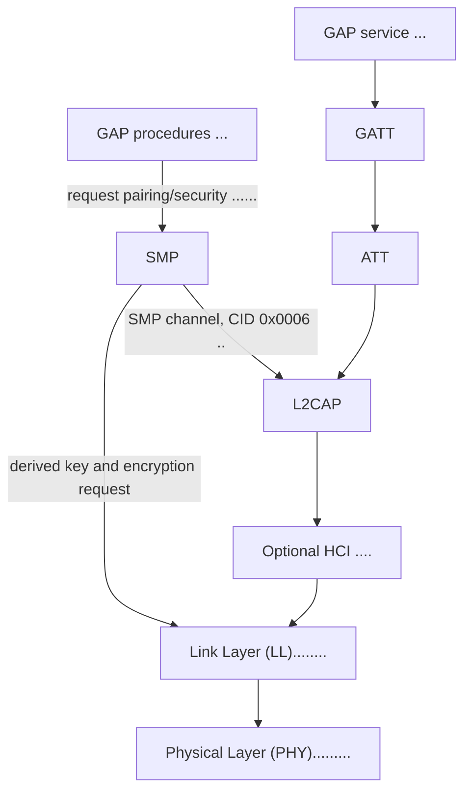

## LE roles

| Role | What it does | Typical use |
| --- | --- | --- |
| Broadcaster | Sends advertising packets without accepting connections. | Beacons and one-way broadcasts. |
| Observer | Scans for advertising packets without initiating connections. | Scanning and discovery applications. |
| Peripheral | Advertises connectably and accepts a connection initiated by a Central. | A sensor or accessory that waits for a host to connect. |
| Central | Scans for connectable advertisers and initiates a connection. | A phone, gateway, or host that connects to peripherals. |

A device can support more than one role. In a connection, the Central initiates
the link and the Peripheral accepts it; either side can provide GATT client or
server functionality, though Central clients and Peripheral servers are common.

## GAP state sizes

These are `sizeof` results for the CH582 target ABI (`rv32imac`, `ilp32`).
`gap_conn_context` is one entry; the stack allocates
`GAP_CONNECTION_COUNT` entries (2 by default). The table lists the structures
you asked about, their allocation scope, and the relevant build configuration.
The Central-only and Peripheral-only fields share storage, as do the requested
connection-parameter bounds and the selected update parameters. Together these
unions save 16 bytes per connection on this ABI; the listed sizes include them.
With `GAP_PERIPHERAL_SUPPORT=0` (Central-only), the Peripheral member is omitted
from each connection context, saving another 32 bytes per link on the CH582 ABI.
The table's advertising sizes assume `GAP_LEGACY_ADV_SUPPORT=1` (the default).
Setting it to `0` omits `gap_adv` and `adv_evt` and removes the legacy payload
from `adv_tx`; Central builds retain its 36-byte connection request.

| Structure | Purpose | Size | Allocation / build configuration |
| --- | --- | ---: | --- |
| `gap_conn_context` | Per-link connection, timing, Link Layer, and procedure state. | 576 bytes each (1,152 bytes for 2 links) | `GAP_EXT_ADV_SUPPORT=0`, `GAP_CONN_DATA_MAX=27`, `GAP_SECURITY_SUPPORT=1` |
| `gap_conn_context` | Per-link connection, timing, Link Layer, and procedure state. | 712 bytes each (1,424 bytes for 2 links) | `GAP_EXT_ADV_SUPPORT=0`, `GAP_CONN_DATA_MAX=27`, `GAP_SECURITY_SUPPORT=2` |
| `gap_conn_context` | Per-link connection, timing, Link Layer, and procedure state. | 624 bytes each (1,248 bytes for 2 links) | `GAP_EXT_ADV_SUPPORT=1`, `GAP_CONN_DATA_MAX=35`, `GAP_SECURITY_SUPPORT=1` |
| `gap_conn_context` | Per-link connection, timing, Link Layer, and procedure state. | 760 bytes each (1,520 bytes for 2 links) | `GAP_EXT_ADV_SUPPORT=1`, `GAP_CONN_DATA_MAX=35`, `GAP_SECURITY_SUPPORT=2` |
| `gap_conn_context` | Per-link connection, timing, Link Layer, and procedure state. | 1,704 bytes each (3,408 bytes for 2 links) | `GAP_EXT_ADV_SUPPORT=1`, `GAP_CONN_DATA_MAX=251`, `GAP_SECURITY_SUPPORT=1` |
| `gap_conn_context` | Per-link connection, timing, Link Layer, and procedure state. | 1,840 bytes each (3,680 bytes for 2 links) | `GAP_EXT_ADV_SUPPORT=1`, `GAP_CONN_DATA_MAX=251`, `GAP_SECURITY_SUPPORT=2` |
| `gap_scanner` | Scan timing, discovery mode, and duplicate-filter settings. | 10 bytes | One global scanner state |
| `gap_adv` | Legacy advertising addresses, timing, and status. | 28 bytes | One global state; payload storage is in `adv_tx` |
| `gap_initiator` | Central initiation mode, peer, and timeout state. | 20 bytes with Central support; omitted without | One global state; compiled only when `GAP_CENTRAL_SUPPORT=1` |
| `adv_tx` | Legacy advertising payloads or a Central connection request. | 64 bytes with Central support; 62 bytes without | One global buffer; `GAP_ADV_DATA_MAX=31`; request and payload share storage |
| `adv_evt` | Advertising and scan-response radio frames plus connection-request event data. | 128 bytes | One global event state; `GAP_ADV_DATA_MAX=31` |
| `gap_security_context` | Per-link encryption keys, counters, and encryption procedure state. | 112 bytes | Embedded in each `gap_conn_context`; already counted above |
| `gap_smp_context` | Per-link pairing, SMP L2CAP, and Secure Connections procedure state. | 5,876 bytes each | SMP enabled; one per connection (`GAP_CONNECTION_COUNT`, 2 by default) |
| `gap_pair_cfg` | Global pairing policy, such as IO capability and bonding options. | 7 bytes | One global pairing configuration |

The SMP-enabled `gap_conn_context` size includes its per-link bond record, but
not the separate `gap_smp_context` array. The 128-byte `adv_evt` contains the
advertising and scan-response radio frames, connection-request frame, and its
receive timestamp. The table above does not include extended advertising
buffers or every other GAP global; selected additional legacy allocations
follow.

With Central support enabled, `adv_tx` saves 34 bytes compared
with separate legacy advertising payloads and a Central connection-request
buffer. With `GAP_CENTRAL_SUPPORT=0`, the Central state and request buffer are
omitted; the two legacy advertising payload buffers remain.

### Additional legacy GAP allocations

These additional sizes were measured for the CH582 ABI with
`GAP_EXT_ADV_SUPPORT=0`, `GAP_CONN_DATA_MAX=27`, and
`GAP_SECURITY_SUPPORT=1`.
Array totals use the default counts shown in the configuration column.

| Allocation | Purpose | Size | Configuration |
| --- | --- | ---: | --- |
| `gap_scan_reports` | Queue of parsed legacy advertising reports. | 228 bytes | 4 reports × 57 bytes each |
| `gap_scan_seen` | Cache for duplicate filtering and scan-response matching. | 160 bytes | 4 entries × 40 bytes each |
| `gap_scan` | Scan scheduling, active-scan request, and queue bookkeeping. | 48 bytes | One global state |
| `gap_rx` | Shared received Link Layer packet and RSSI. | 41 bytes | One global buffer |
| `gap_adv_scan` | Received advertising packet and RSSI awaiting processing. | 41 bytes | One global buffer |
| `gap_identities` | Configured peer identities and privacy/filter policy. | 200 bytes | 4 identities |
| `gap_accept_list` | Controller accept-list addresses and per-entry used flags. | 32 bytes | 4 entries × 8 bytes |

Extended advertising adds further buffers and queues whose total depends on
`GAP_EXT_ADV_DATA_MAX` and the configured set, report, and sync counts; those
allocations are not included in the legacy-only measurements above.

