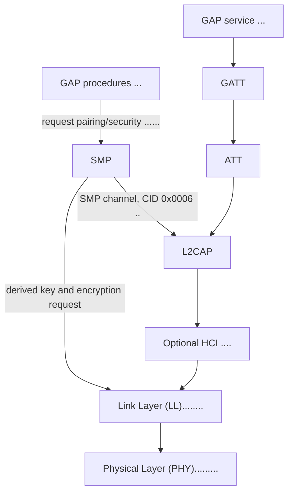

## LE roles

| Role | What it does | Typical use |
| --- | --- | --- |
| Broadcaster | Sends advertising packets without accepting connections. | Beacons and one-way broadcasts. |
| Observer | Scans for advertising packets without initiating connections. | Scanning and discovery applications. |
| Peripheral | Advertises connectably and accepts a connection initiated by a Central. | A sensor or accessory that waits for a host to connect. |
| Central | Scans for connectable advertisers and initiates a connection. | A phone, gateway, or host that connects to peripherals. |

A device can support more than one role. In a connection, the Central initiates
the link and the Peripheral accepts it; either side can provide GATT client or
server functionality, though Central clients and Peripheral servers are common.

